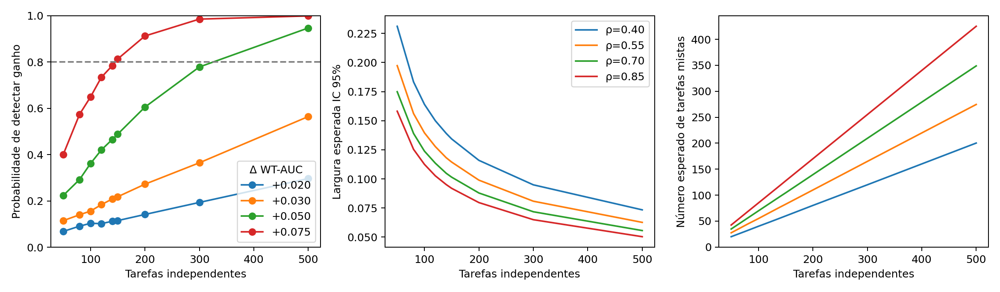

# Poder e precisão prospectivos

A unidade independente é a tarefa. O histórico t=32 contém 132 tarefas,
92 mistas (69.7%); o desvio-padrão das diferenças
pareadas é 0.2664. A correlação dos scores B/H+B é 0.5409.
As distribuições de acertos, tentativas ativas e diferenças estão em
`historical_task_structure.csv`, incluindo variância dos labels/scores,
correlação intratarefa e números de pares positivo-negativo. O arquivo
`historical_full_task_counts.csv` distingue vinte gerações totais de tentativas
ativas em 32 tokens. Tarefas homogêneas não recebem AUC artificial de 0,5.

## Simulação e recomendação

Recomendam-se **100 tarefas externas**, vinte tentativas por tarefa e modelo,
condicionalmente à viabilidade medida no piloto. Cada célula simula 4.000 bancos
de tarefas com seed 20261104. Os efeitos populacionais fixados são 0, +0,02,
+0,03, +0,05 e +0,075. As diferenças históricas são centradas, deslocadas para
o efeito conhecido e, apenas quando necessário, contraídas para permanecer em [-1,1].
Não se usa poder pós-hoc do efeito observado como validação do histórico.

| Efeito verdadeiro | Detecção positiva | Largura IC95% | Mistas esperadas |
|---|---:|---:|---:|
| +0.020 | 10.3% | 0.124 | 69.7 |
| +0.030 | 15.6% | 0.124 | 69.7 |
| +0.050 | 36.1% | 0.124 | 69.7 |
| +0.075 | 64.9% | 0.124 | 69.6 |

Os intervalos da simulação usam aproximação normal studentizada por tarefa;
os intervalos finais usarão bootstrap pareado de tarefas com 10.000 réplicas.
A célula de efeito zero permite verificar o erro de tipo I aproximado no CSV.
As curvas cobrem 50–500 tarefas e frações mistas 0,40, 0,55, 0,85 e a histórica.
A disponibilidade local e o orçamento limitam a recomendação; 500 é cenário de
sensibilidade, não autorização para ampliar o banco buscando significância.
Uma aproximação normal para poder de 80% requer cerca de 1998
tarefas para +0,02, 888 para +0,03, 320 para +0,05
e 143 para +0,075, sob a fração mista e dispersão históricas.
Os primeiros cenários ultrapassam o inventário MBPP+ inteiro. Com 4.000 simulações,
o erro Monte Carlo da estimativa de poder é no máximo aproximadamente 0,8 ponto
percentual de desvio-padrão; a incerteza nas hipóteses de transporte é maior.

## Limites

Ganhos de +0,02 e +0,03 poderão continuar difíceis de distinguir. A amostra não
promete equivalência nem conclusividade para efeitos pequenos. Vinte tentativas
melhoram a observação intratarefa; não equivalem a vinte tarefas independentes.
O modelo de planejamento preserva a dispersão empírica dos efeitos pareados,
não toda a distribuição conjunta dos tokens e do ajuste dos probes.

O cenário principal é condicional a preditores fixos. As sensibilidades com
desvio-padrão de treinamento 0,01 e 0,02 acrescentam um erro comum por banco;
esses números são hipóteses, não variabilidade estimada por reajustes. O CSV
separa explicitamente esses cenários. Uma análise que não repete o ajuste e a
seleção não caracteriza integralmente a incerteza do procedimento. O transporte
de Qwen/HumanEval para DeepSeek/MBPP permanece uma aproximação de planejamento.

## Repetição efetiva do procedimento na origem

Além das sensibilidades hipotéticas, foram executados **8
reajustes completos** das quatro famílias Qwen, incluindo seleção de
hiperparâmetros, PCA, early stopping, três seeds, refit e calibração.
Reservaram-se 26 tarefas exclusivamente para
auditar essa estabilidade. Cada repetição amostrou sem reposição
84 das 106 tarefas
restantes. Nenhum rótulo MBPP novo foi lido. A subamostragem evita duplicar uma
mesma tarefa entre folds, mas não é bootstrap de treinamento.

O desvio-padrão das diferenças de WT-AUC entre repetições foi
0.0360 para a classe linear e
0.0450 para MLP, no mesmo conjunto de
auditoria de origem. Valores e frequências de seleção estão em
`qwen_training_sensitivity.csv` e `.json`; curvas ilustrativas com esses desvios
estão em `power_training_sensitivity.csv`.

Oito subamostras sobrepostas, um conjunto de auditoria pequeno e um tamanho de
treino reduzido não estimam sem viés a variância do procedimento final. As curvas
adicionais são sensibilidades empíricas, não correção formal dos IC externos nem
evidência de superioridade de uma família. O IC principal continua condicional
aos probes congelados. A estabilidade entre as três seeds é publicada
separadamente nas losses dos folds e nenhum membro é selecionado por desempenho.
